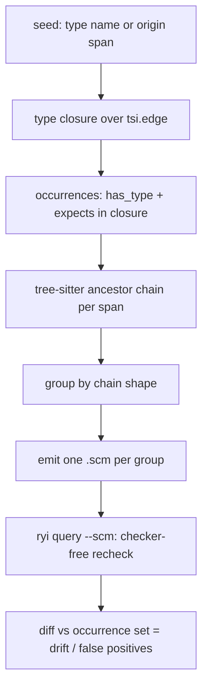

# ryi: inside-out type reachability -> shrinkwrapped static queries

Date: 2026-10-30

Goal (user): seed one type (an important `keyof`, an RTKQ endpoint-name union,
`Signal<T>`), find every place that type or any member of its union is resolved
across the codebase, then derive the syntactic patterns those places sit in and
emit them as `.scm` queries. The checker runs once to discover; the emitted
`.scm` set re-runs cheap with no checker (`ryi query --scm ...`).

Today's `plans/ryi-signal-scan/*.scm` is the opposite direction: hand-written
patterns, bottom-up, no type knowledge.

## 1. What the TS tier emits today

Source: `crates/hafley_scm/src/read/lang/ts_checker.mjs` (TS 5 JS API).

| relation | args | emitted for | line |
| --- | --- | --- | --- |
| `tsi.type` | `(type)` | every type reached | `typeId` :284 |
| `tsi.name` | `(type, text)` | `checker.typeToString` (a literal keeps `"getUser"`) | :291 |
| `tsi.origin` | `(type, atom, span)` | declared types | :296 |
| `tsi.primitive` | `(type, class)` | literals widen to `string`/`number` | :299 |
| `tsi.sum` | `(type)` | union | :510 |
| `tsi.edge` | `(edge, owner, label, target, pos)` | union member (label `""`), property (label = name), generic bound (`bound`) | :362, :392, :517 |
| `tsi.has_type` | `(span, type)` | identifiers and generic type refs only | :591, :623 |
| `tsi.denotes` | `(symbol, type)` | declarations | :583 |
| `tsi.called` / `tsi.argument` | application | generic applications | :538 |

Gaps for the RTKQ / keyof case:

| gap | effect | fix |
| --- | --- | --- |
| no occurrence for string literals | `useX("getUser")`, `endpoints["getUser"]` produce no row | add `ts.isStringLiteral(node)` / `ts.isNoSubstitutionTemplateLiteral` to `occurrence` |
| no contextual type | a literal's own type is `"getUser"`; the `keyof Api` it was checked against is lost | new `tsi.expects(span, type)` from `checker.getContextualType(node)` |
| `keyof T` not walked as index type | `TypeFlags.Index` falls through `walkType` | resolve with `checker.getApparentType` / union of `getPropertiesOfType(T)` names, edge label `keyof` |
| mapped key remap (`` `use${Capitalize<K>}Query` ``) | hook property symbol is synthetic | edge from mapped property to source key; TS keeps the source declaration on homomorphic mapped members (unverified for `as` clauses; needs a fixture) |
| TS 7.1 | `ts_checker.mjs` uses the TS 5 JS API (`ts.sys`, `ts.factory`, `type.symbol`); 7.1 ships a different API (`typescript/unstable/sync`, `typescript/unstable/ast`, MessagePack over stdio, `getSymbol()`/`getTypes()` methods) | 7.x preview exposes batched `getTypeAtLocation(nodes[])`, `getSymbolAtLocation(nodes[])`, `getContextualType`, `isTypeAssignableTo` (ccxt/ast-transpiler PR #95). RAM: user's prior 7.1 lab measured it as unusable; lab notes not found under `~/projects` (searched `7.1`, `getSnapshot`, `typescript/api`) |

Local 7.1 facts (`~/projects/hafley-rs-wt/ryi-reconcile/crates/sprefa-extract/`):

| fact | source |
| --- | --- |
| slow tier plan: one `tsgo --api` server, one `Snapshot` per tsconfig, `Drop` = dispose | `plans/ts71-snapshot-slow-tier.md` |
| server memory never freed until `releaseSnapshot`/close; GOMEMLIMIT 1GiB: 1489 -> 1463 MB, +36% wall | same, facts paragraph |
| TS 5.9 (601 files) server RSS by phase: open 295 MB, call symbols 644, call types 720, every-identifier symbols 1322 | `plans/ts71-api-bench.md:117-128` |
| vscode: server 3-4 GiB, 5+ min per run | `plans/ts71-api-bench.md:17` |
| `getTypeAtPosition(file, positions[])` batched; `getTypeOfSymbol(symbols[])` batched | `ts7/node_modules/typescript/dist/api/async/api.d.ts:219-236` |
| `getContextualType(node: Expression)` single node, one RPC per literal | same `:239` |
| `isTypeAssignableTo(source, target)` | same `:246` |
| `getPropertiesOfType(type)`, union `getTypes()`, index `getIndexType()` | same `:281`, `:446`, `:452` |

Memory driver in that table: the every-identifier sweep (+600 MB over call
symbols on TS 5.9). The inside-out pass never sweeps every identifier.

RAM bound for the inside-out pass: the checker answers only spans in the
seed's closure. Pass 1 = tree-sitter candidates
(cheap, no checker); pass 2 = batched type queries over those spans only,
files in fixed-size batches with the program/snapshot released between batches.

## 2. Inside-out pipeline



### Types

```rust
/// One seed: the type to trace, by printed name or by declaration span.
enum Seed { Name(String), Origin { path: String, start: u32 } }

/// Which way the closure walks tsi.edge.
enum Direction {
    Down, // seed -> members: keyof Api -> "getUser" | "listUsers"
    Up,   // containers of seed: Api -> endpoints map -> hook mapped type
    Both,
}

struct Occurrence { path: String, start: u32, end: u32, type_id: i64, via: Via }
enum Via { HasType, Expects }

/// One shrinkwrap group: a CST ancestor chain shape and its members.
struct Shape {
    chain: Vec<(String /*kind*/, Option<String> /*field*/)>, // leaf .. root, depth k
    scm: String,                 // minted query, leaf captured as @site
    members: Vec<Occurrence>,
}
```

### Closure as SQL over the existing tables

```sql
-- seed ids
WITH RECURSIVE seed(id) AS (
  SELECT json_extract(args,'$[0].id') FROM fact
  WHERE relation='tsi.name' AND json_extract(args,'$[1].text') = ?1),
down(id, depth) AS (
  SELECT id, 0 FROM seed
  UNION
  SELECT json_extract(e.args,'$[3].id'), d.depth+1
  FROM down d JOIN fact e ON e.relation='tsi.edge'
   AND json_extract(e.args,'$[1].id') = d.id
  WHERE d.depth < 32)
SELECT h.args FROM fact h
WHERE h.relation IN ('tsi.has_type','tsi.expects')
  AND json_extract(h.args,'$[1].id') IN (SELECT id FROM down);
```

`Up` swaps `$[1]`/`$[3]`. Literal identity: two files print the same
`"getUser"` literal under different type ids per checker run; key the join on
`tsi.name` text for literal types, on id otherwise.

### Shrinkwrap step

Per occurrence: parse the file once (same loop as `0_query.rs`), find the
smallest node covering `[start,end)`, walk `k` parents (default 3), record
`(kind, field_name)`. Group by chain. Each group mints:

```scheme
; k=2 example for useQuery("getUser")
(call_expression
  function: (identifier) @fn
  arguments: (arguments (string) @site))
```

Literal text and identifier names are not baked in; the minted query keeps
shape only, so the recheck reports the over-approximation (sites with the
same shape whose type is outside the closure). That diff is the precision
number per shape. A shape with zero false positives is a safe static rule.

## 3. Storage and timeline

| step | reads | writes | runs |
| --- | --- | --- | --- |
| checker pass | source, tsconfig | `fact` rows (tsi.*) in `--sqlite` db | once per revision (slow) |
| closure | `fact` | temp `occ` table | per seed (ms, SQL) |
| shrinkwrap | `occ`, source bytes | `shape` table + `.scm` files | per seed |
| recheck | `.scm`, source | jsonl | every edit (fast path, ~0.9 s parse floor on hafley-rxjs) |

Uniqueness: occurrence = `(path, start, end, via)`; shape = canonical chain
string; type closure keyed by id within one run, by `tsi.name` text across runs.

## 4. RTKQ trace example (expected chain, needs fixture)

```
openapi operationId "getUser"
 -> codegen: endpoints: { getUser: build.query<...> }        (property edge, label getUser)
 -> api.endpoints: typeof endpoints                           (has_type on `endpoints`)
 -> hooks: { useGetUserQuery } via mapped key remap           (mapped edge, gap above)
 -> keyof typeof api.endpoints  = "getUser" | ...             (Index type, gap above)
 -> call sites: api.endpoints.getUser.select(), useGetUserQuery(), selectFn("getUser")
                                                              (has_type / expects)
```
